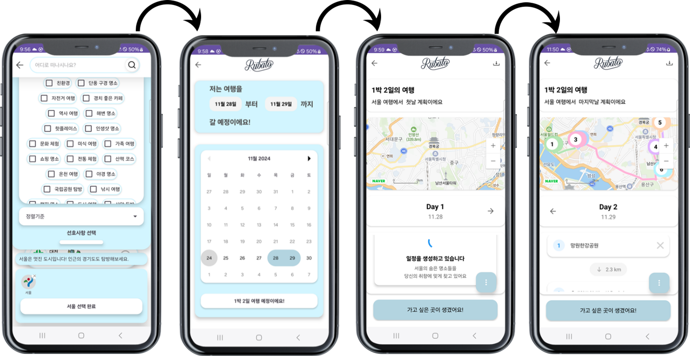
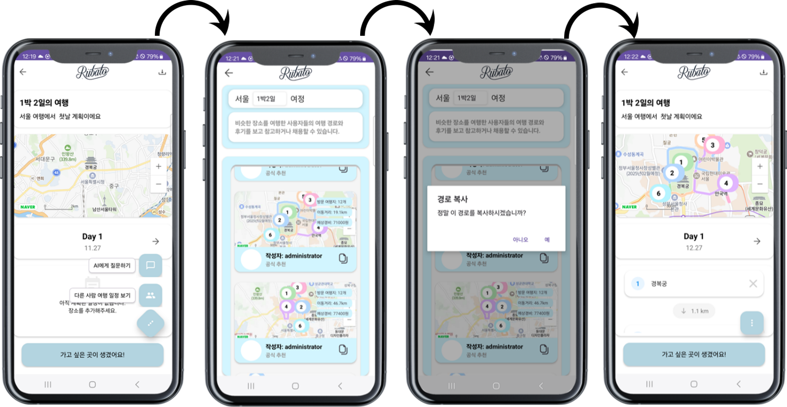
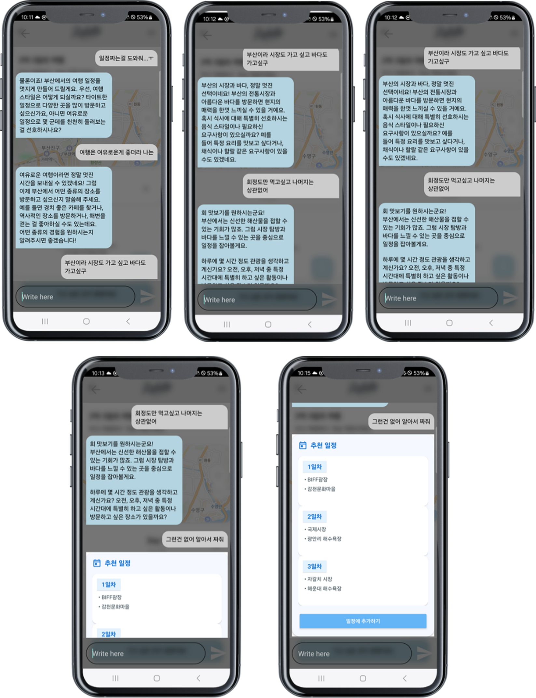
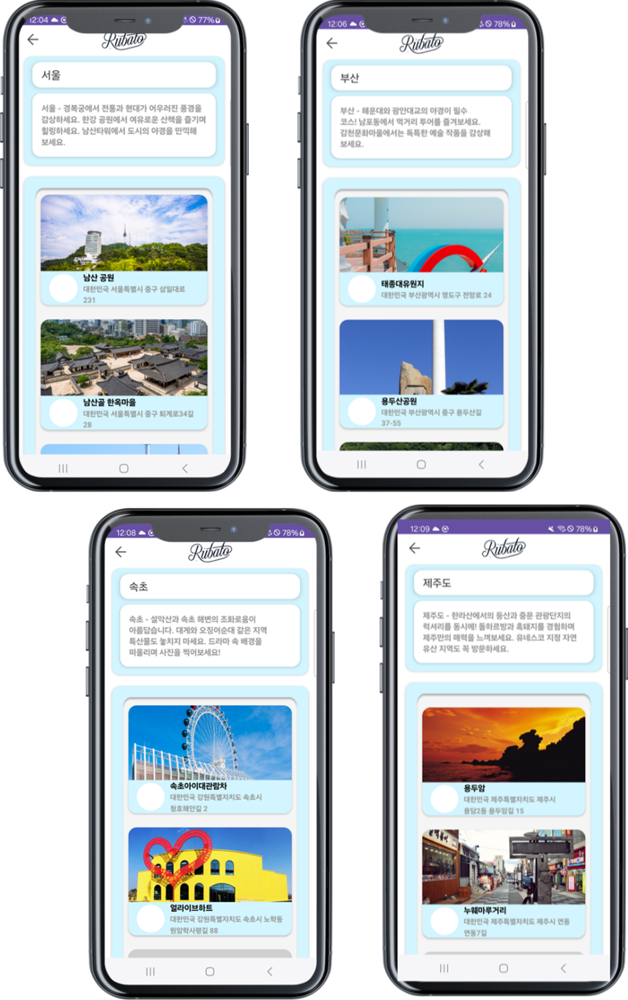
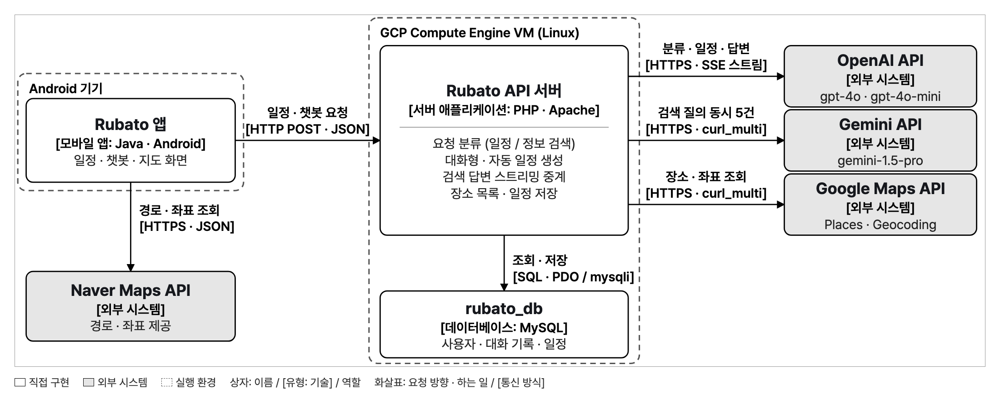

# Rubato

지역 · 기간 · 취향 태그를 고르거나 챗봇과 대화해 여행 일정을 만들고, 지도에서 동선을 확인하는 Android 앱입니다.

| 항목 | 내용 |
| --- | --- |
| 구분 | 전문학사 졸업작품 |
| 기간 | 2024.06 ~ 2024.11 |
| 인원 | 5인 팀 (팀장) |
| 담당 | 서버(PHP API, MySQL) 구축과 AI 연동 전담. 앱 화면은 프론트 담당 팀원이 구현하고 본인은 보조 |
| 수상 | 2024 LINC 3.0 캡스톤디자인 경진대회 대상 (연성대학교 교내, 2024.11) |
| 시연 | [전체 시연 영상 · 기능별 클립 · APK](https://github.com/deltaomega02/rubato/releases/tag/v1.0) |

| 태그 선택과 일정 생성 | 지도에서 동선 확인 |
| --- | --- |
|  |  |

| 여행 챗봇 | 지역별 장소 추천 |
| --- | --- |
|  |  |

## 구현 환경

| 분류 | 사용 기술 | 선택 이유 |
| --- | --- | --- |
| 언어 | PHP (서버) · Java (앱) | |
| 서버 | Apache + PHP (프레임워크 없음) | 프레임워크 사용 경험이 없던 시기라 PHP 스크립트만으로 구성 |
| 데이터베이스 | MySQL | 경로–태그, 경로–지역의 다대다 관계를 중간 테이블로 표현 |
| 클라우드 플랫폼 | GCP Compute Engine | Linux VM에서 PHP 서버를 실행하고 앱이 VM 주소로 접속 |
| 앱 | Android SDK (compileSdk 34) · Retrofit2 | 엔드포인트를 인터페이스 하나에 선언, AI 응답 대기에 맞춰 타임아웃 180초 |

## 시스템 아키텍처



| 구간 | 구성 |
| --- | --- |
| 앱 ↔ 서버 | Retrofit2로 HTTP POST (JSON 본문). 챗봇 응답은 OpenAI 스트림(SSE 형식)을 서버가 그대로 중계하고 앱이 `data:` 줄 단위로 파싱 |
| 서버 | 기능마다 PHP 파일 하나를 Apache에서 실행. `chat_main.php`가 요청을 분류한 뒤 `chat_route.php` 또는 `chat_search.php`를 `include`로 실행 |
| 데이터베이스 | PDO · mysqli prepared statement. 테이블: `User`, `session_state`, `chat_history`, `Tag`, `Theme`, `Route`, `Route_detail`, `Route_Tag`, `Route_Area` |
| 서버 → 외부 | cURL HTTPS 호출 (OpenAI `/v1/chat/completions`, Gemini `generateContent`, Google `place/textsearch` · `geocode`). 여러 요청은 `curl_multi`로 동시 실행 (Gemini 검색은 최대 5개씩) |
| 앱 → Naver | 지도는 Naver Map SDK, 경로 · 구간 거리는 Directions API를 앱에서 직접 호출 |

구조도는 이 저장소에 있는 스크립트 기준입니다. 로그인 · 회원가입 스크립트는 저장소에 포함되어 있지 않습니다.

## 구현 기능 (서버)

- `chat_main.php`: GPT-4o-mini로 요청 유형(`schedule` / `information`) 분류, 세션 유형을 `session_state`에 UPSERT
- `chat_route.php`: `chat_history`의 대화 맥락과 장소 목록을 프롬프트에 넣어 GPT-4o 스트리밍으로 일정(JSON) 생성, 누락된 주소 · 좌표는 Places · Geocoding으로 보완
- `chat_search.php`: GPT-4o로 키워드 추출 → Gemini 1.5 Pro 검색 grounding 병렬 호출 → GPT-4o 스트리밍 답변
- `get_place.php`: Places Text Search로 지역별 관광지 · 식당 수집, 좌표 조회와 태그 분류(GPT-4o-mini)를 `curl_multi`로 병렬 요청
- `save_route.php`: 장소별 비용 검색, 태그 · 테마 선택, 점수 계산 후 `Route` 외 3개 테이블에 트랜잭션으로 저장 (실패 시 rollback)

## 문제 해결

### 1. 일정 요청과 정보 질문을 구분하지 못하던 문제: GPT-4o-mini 사전 분류와 세션 상태 저장

- **문제**: 일정 생성 요청과 장소 정보 질문을 먼저 구분해야 처리 경로 결정 가능
- **1차**: 특정 단어를 찾는 규칙으로 분류 → 같은 뜻을 표현하는 방식이 다양해 분류 실패
- **2차**: 일정을 만드는 GPT가 필요하다고 판단하면 Gemini 검색을 호출 (OpenAI Structured Outputs로 응답 형식 강제) → 호출이 연달아 이어져 응답 지연
- **해결**: `chat_main.php`에서 GPT-4o-mini가 `schedule` / `information`만 먼저 판단 → 결과에 따라 `chat_route.php` 또는 `chat_search.php` 한 경로만 실행. 세션 유형을 `session_state` 테이블에 저장해 일정 대화 중에는 분류 생략
- **이유**: 분류 · 태그 · 짧은 문구는 가벼운 GPT-4o-mini, 길고 조건이 많은 일정 생성은 GPT-4o로 역할 분리

```text
POST chat_main.php → session_state 조회 → GPT-4o-mini 요청 분류
  ├─ schedule    → chat_route.php  → GPT-4o 스트리밍 · chat_history 저장
  └─ information → chat_search.php → GPT-4o 키워드 추출 → Gemini 1.5 Pro (curl_multi 동시 5개) → GPT-4o 스트리밍 답변
```

### 2. GPT가 답하지 못하는 최신 정보 질문: Gemini 검색 grounding 병렬 호출

- **문제**: 영업시간 · 요금 같은 최신 정보는 GPT만으로 답변 불가 → 검색 기능을 추가
- **해결**: GPT-4o가 질문에서 키워드와 카테고리 추출 → 검색어 생성 → Gemini 1.5 Pro(`google_search_retrieval`)를 `curl_multi`로 최대 5개 동시 호출 → 검색 결과를 GPT-4o가 정리해 스트리밍 응답
- **이유**: 구글 검색 결과를 근거로 답하는 도구가 Gemini에 있었고, 검색어가 여러 개라 순차 호출 시 대기 시간 합산

### 3. 장소 조회가 느리던 문제: curl_multi로 외부 API 요청 병렬화

- **문제**: 지역을 고르면 관광지 · 식당 목록을 만드는데, 장소마다 좌표 조회와 태그 분류 요청을 하나씩 보내 조회 지연 발생
- **해결**: Places Text Search로 장소 수집 → Geocoding 요청을 `curl_multi` 핸들에 묶어 동시 실행 → 장소별 태그 4개 선택(GPT-4o-mini) 요청도 묶어 동시 실행
- **이유**: PHP에서 별도 워커나 큐 없이 여러 HTTP 요청을 동시에 진행하는 방법으로 `curl_multi` 선택

## 한계

- 프레임워크 없이 개발해 파일마다 DB 연결 코드를 반복 작성 (PDO와 mysqli 혼용)
- 일정 대화가 시작되면 세션이 일정 모드로 고정되어, 대화 도중 정보 질문으로 바뀌는 흐름은 미처리
- AI 응답 형식을 프롬프트 지시와 사후 `json_decode` 검사로만 통제

## 실행 방법

공개 코드만으로 전체 앱 흐름을 재현할 수는 없습니다.
앱의 [ApiService.java](Rubato_Application/app/src/main/java/com/ysu/capstone/network/ApiService.java)가 호출하는 `login.php`, `auto_route_new.php`, `save_route_3.php` 등이 서버 폴더에 빠져 있습니다.
전체 동작은 상단의 시연 영상으로 확인할 수 있고, 로컬에서 구동하려면 누락된 엔드포인트를 따로 채워 넣어야 합니다.

1. `Rubato_Application/`을 Android Studio로 엽니다. 환경 설정은 `compileSdk 34`, `targetSdk 34`, `minSdk 32`이며 Gradle Wrapper 버전은 8.7입니다.
2. PHP와 MySQL 환경을 구성하고 ERD와 서버 PHP의 쿼리를 함께 참고해 `rubato_db` 데이터베이스와 테이블을 만듭니다.
3. 서버 환경 변수에 `OPENAI_API_KEY`를 등록하고, PHP 파일 안에 적힌 `YOUR_GOOGLE_API_KEY` 및 DB 접속 계정을 수정합니다.
4. `Rubato_Application/app/src/main/java/com/ysu/capstone/network/RetrofitClient.java`의 `BASE_URL`과 `Rubato_Server/get_place.php`의 내부 호출 주소를 실행 중인 서버 IP로 맞춥니다.
5. `Rubato_Application/app/src/main/` 경로의 `AndroidManifest.xml`, `res/values/strings.xml`(`naver_api_key_id`, `naver_api_key`), `Rubato_Application/app/build.gradle.kts`(`NAVER_CLIENT_ID`, `NAVER_CLIENT_SECRET`)에 본인의 네이버 지도 API 인증 정보를 넣습니다.
6. Gradle 동기화를 마치고 API 32 이상 단말기나 에뮬레이터에서 앱을 실행합니다.

cURL, PDO MySQL, mysqli, mbstring 등의 PHP 확장이 활성화되어 있어야 정상적으로 동작합니다.

## 관련 문서

* [기능명세서 및 WBS](docs/RUBATO_기능명세서%20및%20WBS.xlsx)
* [화면설계서](docs/RUBATO_화면설계서.pptx)
* [ERD](docs/rubato_db_ERD.png) · [테이블 명세서](docs/RUBATO_테이블명세서.xlsx)
* [발표자료](docs/RUBATO_GEMFES_TEMPLATE.pdf)
* [캡스톤디자인 결과보고서](docs/캡스톤디자인%20팀별결과보고서.pptx)
