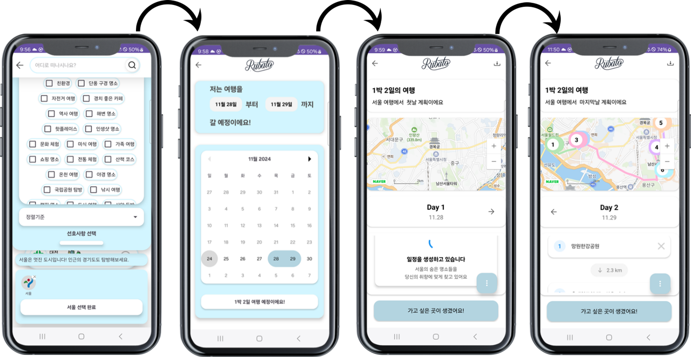
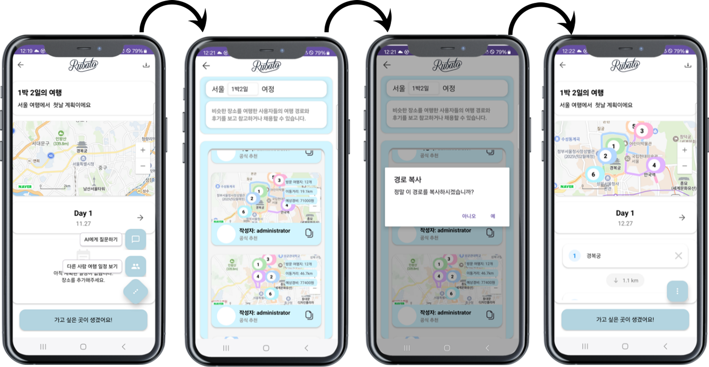
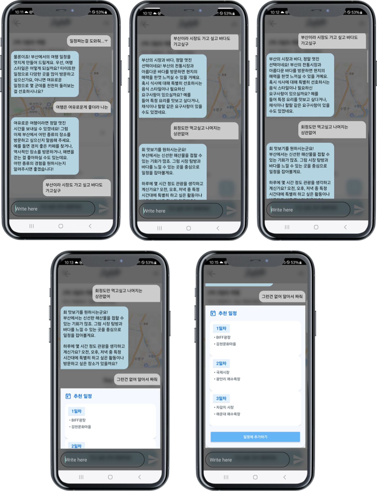
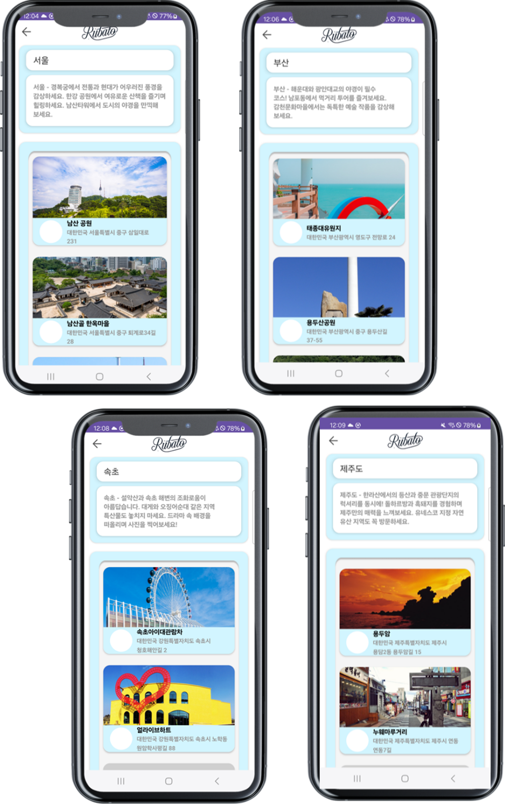
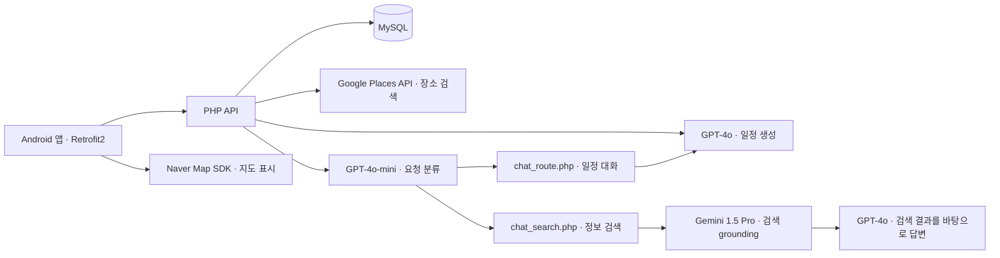

# Rubato

여행지·기간·취향 태그를 고르면 AI가 일정을 만들고, 네이버 지도에서 방문 순서와 동선을 확인하는 Android 앱입니다.

* 전문학사 졸업작품으로 만든 5인 팀 프로젝트입니다.
* 박시우는 팀장으로 기획·일정 관리(WBS)·서버 구축·AI 로직 구현을 담당했습니다.
* 2024 LINC 3.0 캡스톤디자인 경진대회에서 팀명 DeltaOmega로 대상을 수상했습니다.

[전체 시연 영상·기능별 클립·APK](https://github.com/deltaomega02/rubato/releases/tag/v1.0)

## 프로젝트 소개

여행 계획을 세울 때는 가고 싶은 장소를 찾는 일 외에도 동선 순서를 맞추고 영업시간이나 주차 여부를 확인하는 번거로움이 따릅니다.
Rubato는 취향에 맞춘 일정 생성부터 지도 위 동선 확인, 여행 정보 질문까지 앱 하나로 처리하도록 묶었습니다.
태그를 선택해 일정을 바로 만들거나 챗봇과 대화하며 세부 계획을 조율할 수 있습니다.

## 주요 기능

| 태그 선택과 일정 생성 | 지도에서 동선 확인 |
| --- | --- |
|  |  |
| 여행지·기간·취향 태그를 일정 생성 요청에 반영합니다. | 생성된 일정의 장소와 이동 경로를 네이버 지도에 표시합니다. |

| 여행 챗봇 | 지역별 장소 추천 |
| --- | --- |
|  |  |
| 대화로 일정을 구성하거나 여행 정보를 질문합니다. | 지역과 태그에 맞는 장소를 검색하고 확인합니다. |

## 기술 스택

| 구분 | 기술과 역할 |
| --- | --- |
| Android 앱 | Java, Retrofit2로 화면과 서버 통신을 구현했습니다. |
| 지도 | Naver Map SDK로 장소와 동선을 표시합니다. |
| 서버·DB | PHP로 요청을 처리하고 MySQL에 데이터를 저장합니다. |
| 일정 생성 | GPT-4o를 사용합니다. |
| 요청 분류·장소 태그 분류·지역 안내 문구 | GPT-4o-mini를 사용합니다. |
| 여행 정보 검색 | Gemini 1.5 Pro의 검색 grounding을 사용합니다. |
| 장소 검색 | Google Places API를 사용합니다. |

## 아키텍처

앱 코드는 `Rubato_Application/`, 서버 코드는 `Rubato_Server/`에 있습니다.
채팅 진입점인 `chat_main.php`에서 세션 상태와 요청 의도를 먼저 분류한 뒤 하위 파일로 넘깁니다.
일정 생성을 이미 진행 중인 세션이라면 다시 분류를 거치지 않고 바로 `chat_route.php`로 보냅니다.

## 트러블슈팅과 설계 경험

### 실시간 정보 처리 방식을 시제품으로 비교했습니다

영업시간이나 주차 같은 실시간 정보를 어떤 방식으로 처리할지 팀 안에서 의견이 나뉘었습니다.
두 방식을 짧게 시제품으로 만들어 같은 질문을 넣고 비교한 뒤 방향을 정했습니다.
최종 구조에서는 일정 생성과 정보 검색 엔드포인트를 분리하고, 정보 검색에 Gemini의 검색 grounding을 활용했습니다.
검색으로 받아온 최신 결과는 GPT-4o에 넘겨 자연스러운 문장으로 정돈해 사용자에게 응답합니다.

다만 세션이 일정 대화 상태로 묶여 있으면 일반 여행 질문도 일정 처리 로직으로 넘어가기 때문에, 대화 중간에 갑자기 질문 성격이 바뀌는 흐름까지는 유연하게 대응하지 못했습니다.

### PHP 파일마다 공통 코드가 반복됐습니다

API 엔드포인트를 하나씩 추가하다 보니 DB 연결 코드가 파일마다 거의 그대로 복사되었습니다.
별도 프레임워크 없이 단일 스크립트로 처리하다 보니 공통 처리가 흩어졌고, `chat_main.php`와 `chat_route.php`만 봐도 동일한 설정과 연결 루틴을 따로 들고 있었습니다.
Rubato 개발 기간 안에는 이 구조적 중복을 말끔하게 걷어내지 못했습니다.
이때 느낀 유지보수의 한계를 계기로, 다음 졸업작품인 Orbit에서는 계층 분리와 공통 처리가 체계적인 Django REST Framework를 선택했습니다.

## 실행 방법

공개 코드만으로 전체 앱 흐름을 재현할 수는 없습니다.
앱의 [ApiService.java](Rubato_Application/app/src/main/java/com/ysu/capstone/network/ApiService.java)가 호출하는 `login.php`, `auto_route_new.php`, `save_route_3.php` 등이 서버 폴더에 빠져 있습니다.
전체 동작은 상단의 시연 영상으로 확인할 수 있고, 로컬에서 구동하려면 누락된 엔드포인트를 따로 채워 넣어야 합니다.

1. `Rubato_Application/`을 Android Studio로 엽니다. 환경 설정은 `compileSdk 34`, `targetSdk 34`, `minSdk 32`이며 Gradle Wrapper 버전은 8.7입니다.
2. PHP와 MySQL 환경을 구성하고 ERD와 서버 PHP의 쿼리를 함께 참고해 `rubato_db` 데이터베이스와 테이블을 만듭니다.
3. 서버 환경 변수에 `OPENAI_API_KEY`를 등록하고, PHP 파일 안에 적힌 `YOUR_GOOGLE_API_KEY` 및 DB 접속 계정을 수정합니다.
4. `Rubato_Application/app/src/main/java/com/ysu/capstone/network/RetrofitClient.java`의 `BASE_URL`과 `Rubato_Server/get_place.php`의 내부 호출 주소를 실행 중인 서버 IP로 맞춥니다.
5. `Rubato_Application/app/src/main/` 경로의 `AndroidManifest.xml`, `res/values/strings.xml`(`naver_api_key_id`, `naver_api_key`), `Rubato_Application/app/build.gradle.kts`(`NAVER_CLIENT_ID`, `NAVER_CLIENT_SECRET`)에 본인의 네이버 지도 API 인증 정보를 넣습니다.
6. Gradle 동기화를 마치고 API 32 이상 단말기나 에뮬레이터에서 앱을 실행합니다.

cURL, PDO MySQL, mysqli, mbstring 등의 PHP 확장이 활성화되어 있어야 정상적으로 동작합니다.

## 관련 문서

* [기능명세서 및 WBS](docs/RUBATO_기능명세서%20및%20WBS.xlsx)
* [화면설계서](docs/RUBATO_화면설계서.pptx)
* [ERD](docs/rubato_db_ERD.png) · [테이블 명세서](docs/RUBATO_테이블명세서.xlsx)
* [발표자료](docs/RUBATO_GEMFES_TEMPLATE.pdf)
* [캡스톤디자인 결과보고서](docs/캡스톤디자인%20팀별결과보고서.pptx)
